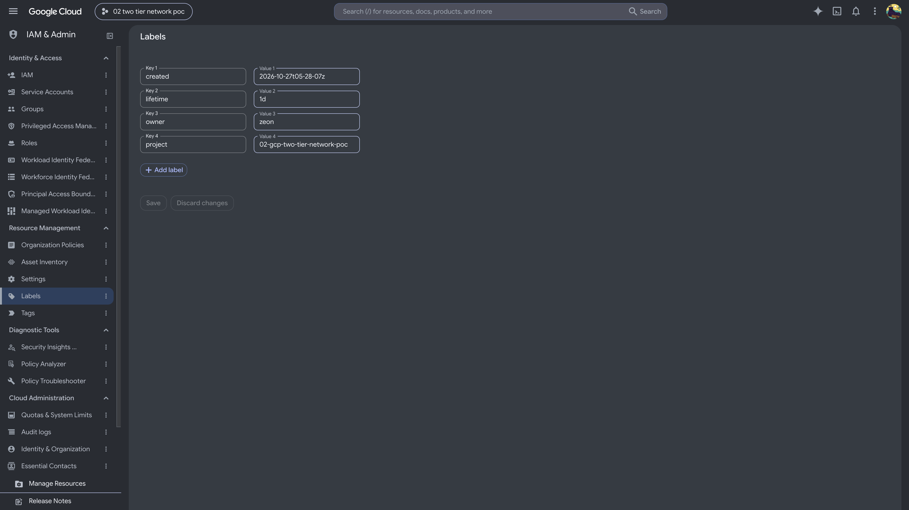
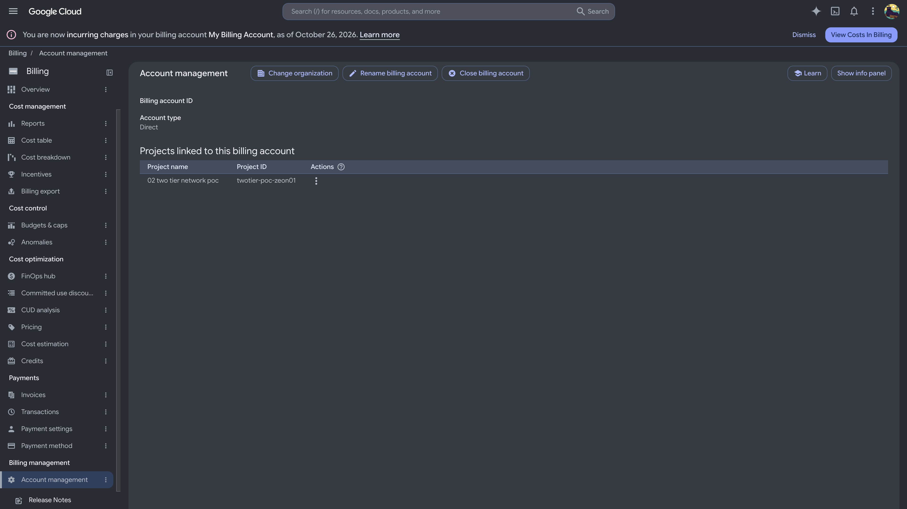
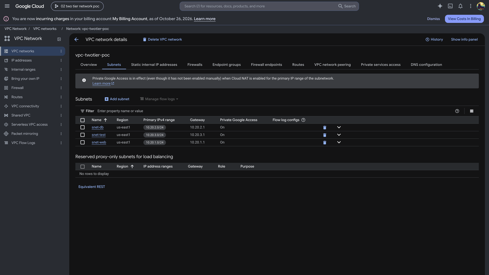
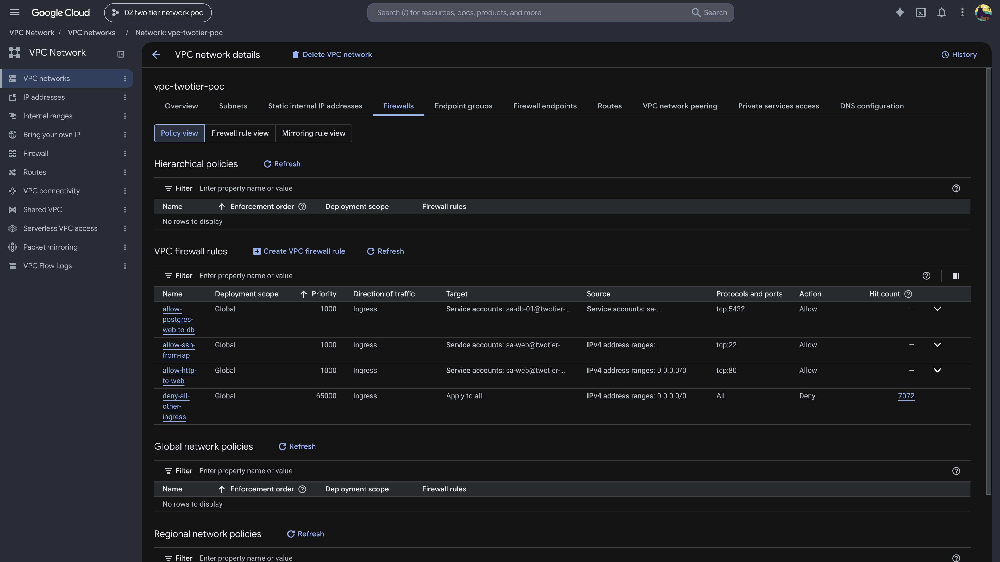
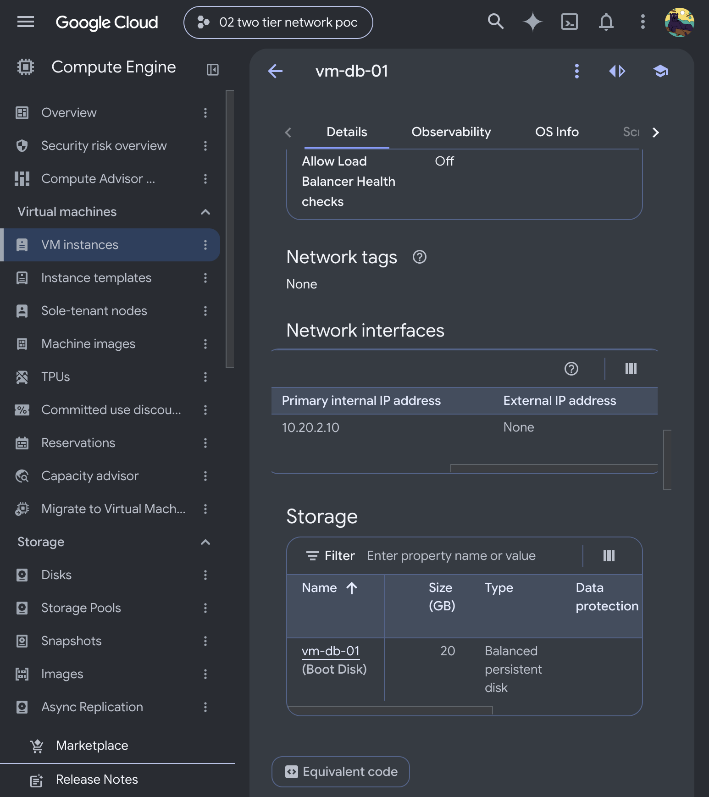
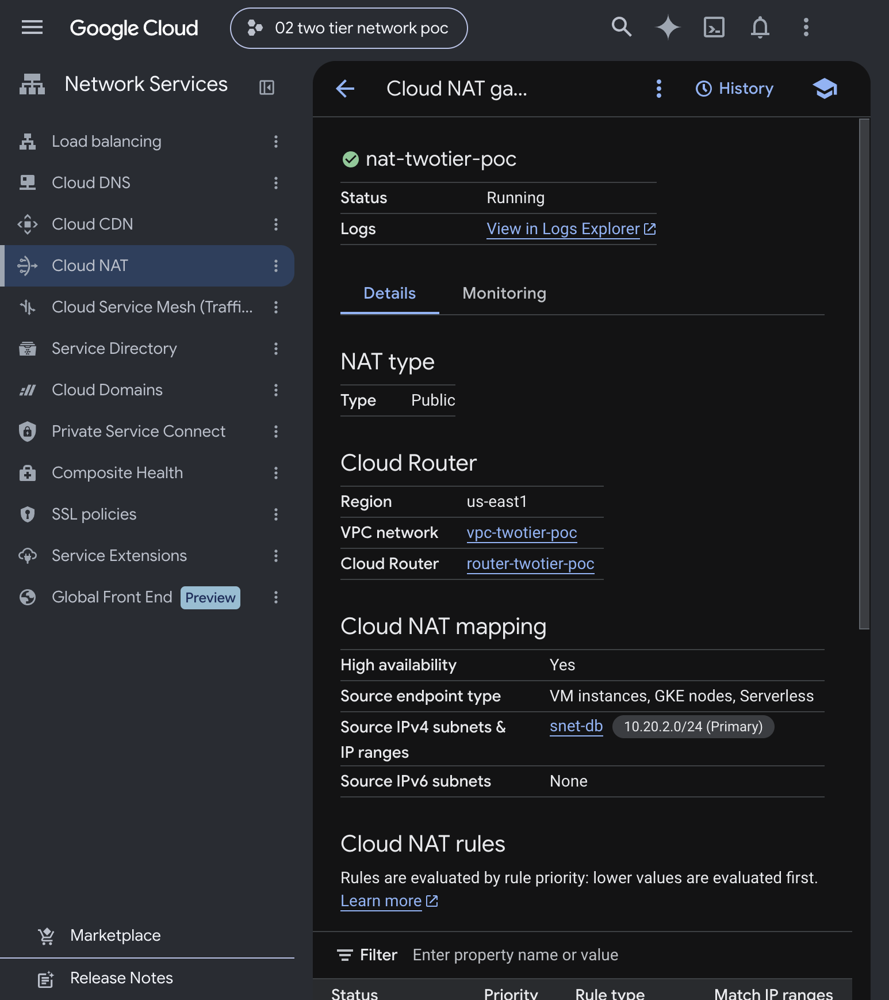
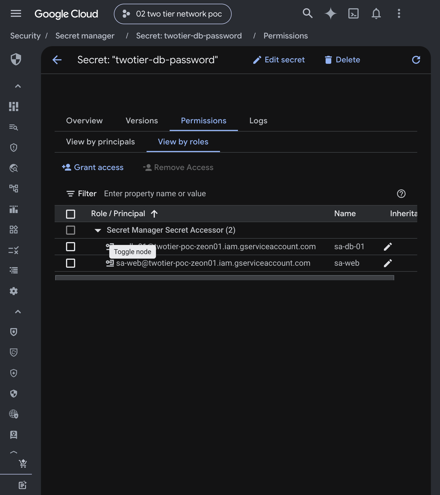
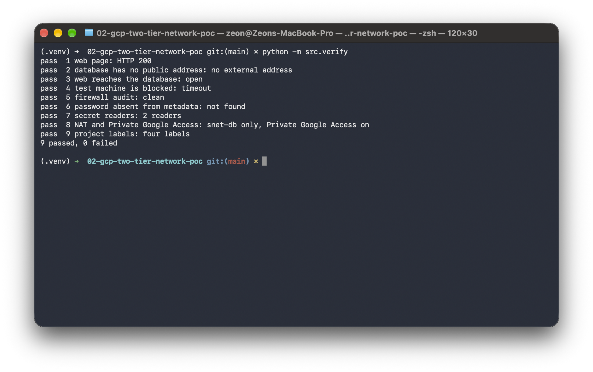
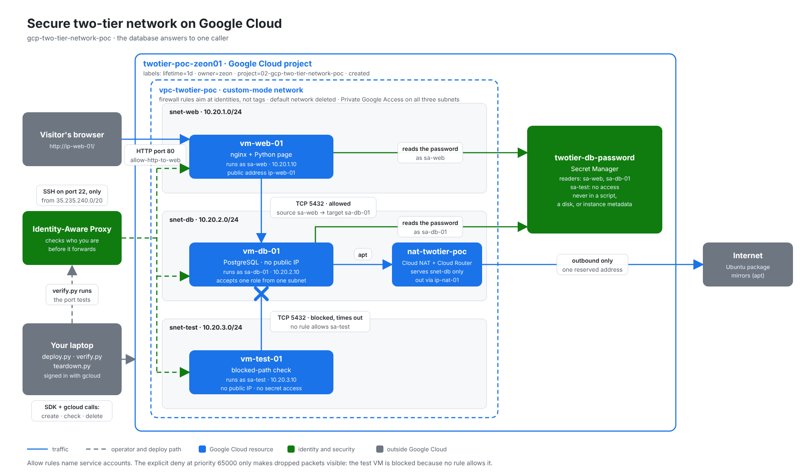
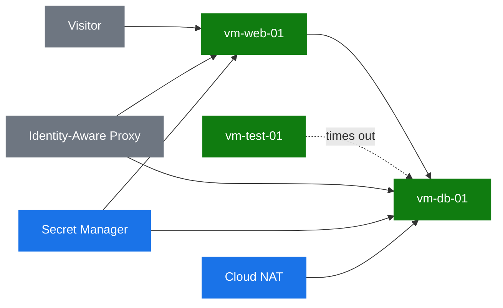

# Two-tier network on Google Cloud

## Watch the build

Video not recorded yet. The thumbnail and the link go here after the recording.

<!-- [](LOOM_LINK) -->

**Page:** [http://35.231.54.196/](http://35.231.54.196/) while the project is up. **Author:** Zeon Stewart, [LinkedIn](LINKEDIN_LINK_HERE)

The page is plain text. It is still up so the console screenshots can be taken. The nightly sweep deletes a project labeled `lifetime=1d` at 11:30 PM if that project is at least an hour old. Take the shots before then, or the page goes away with the project.

## At a glance

- **What it is:** a web page and a database on two virtual machines. The database has no public address. Only the web machine can open the database port.
- **Business problem:** a small application needs a database that the internet cannot reach, without renting a managed database.
- **What's automated:** one script creates the project, the network, the firewall, and the three machines. A second script checks the ten criteria. Teardown asks you to type the project id before it deletes anything.
- **Why it's secure:** the database password is in Secret Manager. It is not in a script, and it is not in a machine's settings. Shell access comes through Identity-Aware Proxy, not a public port 22. The firewall names service accounts, not tags.
- **Result:** `python -m src.verify` printed `9 passed, 0 failed` on October 27, 2026. The tenth check is the teardown, and the project is still up for screenshots. The test machine's connection to the database **timed out**. A timeout means the packet was dropped. A refusal would have meant it arrived.

Part of [Cloud Projects](https://github.com/zsociety47/cloud-projects). Technical details are in [Technical findings](#technical-findings) at the bottom.

---

## Project Steps

These steps are what you click in the [Google Cloud console](https://console.cloud.google.com). The [automated setup](#automated-setup) already did them. Each step names the code that does the same thing.

The project id for this run is `twotier-poc-zeon01`. A deleted project id cannot be reused for up to 30 days.

Screenshots of the console are not in the repository yet. Each of those image lines stays commented out until the file exists. The shot list, including what to crop, is in the private notes. The page shot below is the live page.

### Step 1: Create a project

*Automated by `gcloud projects create` in `src/lib/gcloud.py`.*

1. Open the project picker and select **New project**.
2. **Project name:** `02 two tier network poc`
3. **Project ID:** `twotier-poc-zeon01`
4. Add these four labels. A label value can't contain a colon, so the time uses hyphens.
   - `lifetime` = `1d`
   - `owner` = `zeon`
   - `project` = `02-gcp-two-tier-network-poc`
   - `created` = the time you created it, such as `2026-10-27t05-25-00z`

<!--  -->

### Step 2: Link billing

*Automated by `gcloud billing projects link`.*

Link the billing account. Crop the billing account id out of the shot.

<!--  -->

### Step 3: The network

*Automated by `LiveCloud.ensure_network` and `ensure_subnets`.*

One custom-mode Virtual Private Cloud (VPC) network, `vpc-twotier-poc`. Custom mode means Google does not add automatic subnets. Delete the `default` network. It ships with rules that allow internal traffic and Secure Shell (SSH) from anywhere.

Three subnets, all in `us-east1`, all with Private Google Access on:

| Subnet | Range | Machine |
|---|---|---|
| `snet-web` | `10.20.1.0/24` | `vm-web-01` at `10.20.1.10` |
| `snet-db` | `10.20.2.0/24` | `vm-db-01` at `10.20.2.10` |
| `snet-test` | `10.20.3.0/24` | `vm-test-01` at `10.20.3.10` |

Google reserves the first two and last two addresses of a subnet. `.10` is outside that reservation.

<!--  -->

### Step 4: Firewall rules that name identities

*Automated by `src/lib/rules.py`.*

The rules belong to the whole network. They name service accounts. They do not use network tags.

| Rule | What it allows |
|---|---|
| `allow-http-to-web` | Port 80 from the internet, only to `sa-web` |
| `allow-ssh-from-iap` | Port 22 only from `35.235.240.0/20`, to all three accounts |
| `allow-postgres-web-to-db` | Port 5432 from `sa-web` to `sa-db-01` |
| `deny-all-other-ingress` | Everything else, priority 65000, logging on |

The Identity-Aware Proxy (IAP) range is not "the internet." IAP checks who you are, then forwards the connection from that range.

The explicit deny is not what blocks the test machine. Nothing allows the test machine to open port 5432, so the packet is dropped either way. The deny exists so those drops can be logged. A custom network has no built-in "allow everything inside the network" rule. The `default` network did, which is why it was deleted.

<!--  -->

### Step 5: The database has no public address

*Automated by `LiveCloud.ensure_vm`.*

`vm-db-01` and `vm-test-01` have no external address. `vm-web-01` uses the reserved address `ip-web-01`. Cloud NAT (`nat-twotier-poc` on `router-twotier-poc`) uses `ip-nat-01` and serves `snet-db` only, so the database machine can install packages. The outbound address belongs to the gateway, not the machine.

The database account is `sa-db-01`. The design name `sa-db` is five characters, and the Identity and Access Management API requires six. The architecture picture still says `sa-db`. The code is the name that was created.

<!--  -->

<!--  -->

### Step 6: The password stays in Secret Manager

*Automated by `LiveCloud.ensure_secret`.*

The secret is `twotier-db-password`, with one replica in `us-east1`. The readers are `sa-web` and `sa-db-01`. The test account is not a reader. The value is generated in memory and never printed. Re-running the deploy does not add a second version.

<!--  -->

### Step 7: Open the page

The web machine reads the secret at request time, connects to PostgreSQL on the private address, and returns `database-connected` plus the database version. A failed connection returns `database-unavailable` and does not include the error text.


### Step 8: Check it

```bash
python3 -m src.verify
```

On October 27, 2026 that printed `9 passed, 0 failed`. Row 4 was `timeout`.

<!--  -->

---

## Automated setup

### Run this as yourself

The names committed here are this proof. A later operator replaces only the owner slot.

| File | What to change |
|---|---|
| [`.env.example`](.env.example) | `yourname01` in `GCP_PROJECT_ID`, then copy the file to `.env` and set the billing account id. `.env` is not committed. |
| [`src/lib/config.py`](src/lib/config.py) | `OWNER_LABEL`, if the labels should carry your name instead of `zeon`. |

**Prerequisites:** Python 3.11 or newer, the Google Cloud command-line interface, and `gcloud auth login`. The scripts take a user access token from that login and set this project as the quota project. They do not use Application Default Credentials. Sign in once in the terminal. The console sign-in is a separate browser login, and you need it for the screenshots.

```bash
python3 -m venv .venv
.venv/bin/pip install -r requirements.txt
cp .env.example .env
```

Fill in `GCP_BILLING_ACCOUNT`. Change `GCP_PROJECT_ID` if `twotier-poc-zeon01` is already taken. Don't commit `.env`.

```bash
.venv/bin/python -m src.deploy --plan
.venv/bin/python -m src.deploy
.venv/bin/python -m src.verify
```

`--plan` prints the names and calls nothing. Re-running the deploy reuses a project only when the four labels match, and it does not rotate the password.

Tear it down after the screenshots. Type the project id when asked. A wrong name deletes nothing.

```bash
.venv/bin/python -m src.teardown
.venv/bin/python -m src.verify --after-teardown
```

`--resources-only` keeps the project and deletes what is inside it. Use that while iterating. The recorded ending is the full delete.

---

## Architecture



The print version is [architecture.pdf](docs/architecture/architecture.pdf). The picture still labels the database account `sa-db`. The account that was created is `sa-db-01`.



This proof does not add Hypertext Transfer Protocol Secure (HTTPS), a custom domain, a load balancer, Cloud SQL, Terraform, GitHub Actions, Cloud Armor, VPC Service Controls, or a bastion host.

## Google Cloud and Azure

| Idea | Azure project 2 | This project |
|---|---|---|
| What gets deleted | Resource group | Project |
| Firewall | Network security group on a subnet | VPC firewall rule for the whole network |
| "Only this tier" | Source address | Source service account |
| Trap to remove | Allow-all-inside-the-network at priority 65000 | The `default` network and its allow rules |
| Outbound for a private machine | NAT gateway | Cloud Router plus Cloud NAT |
| Run a command on the machine | Run Command | Startup script, then a guest attribute |
| Reach a machine with no public address | SSH jump through the web machine | Identity-Aware Proxy |
| The password | Was placed in the script | Secret Manager, read at run time |

## Hypothesis

A database virtual machine with no public address can accept PostgreSQL from the web machine only. A third machine in the same network is blocked. The password never has to be written into a script.

## Success criteria

| # | Criterion | How it is checked | Result |
|---|---|---|---|
| 1 | The page loads on port 80 and shows a live database result | HTTP request to `ip-web-01` | ✅ October 27, 2026: HTTP 200 and `database-connected`. PostgreSQL 16.15. |
| 2 | The database machine has no public address | Read `vm-db-01`'s network interface | ✅ No external address |
| 3 | The web machine reaches the database port | Port test on `vm-web-01` | ✅ `open` |
| 4 | A machine in the same network, outside the web tier, is blocked | Same port test on `vm-test-01` | ✅ `timeout`. A `refused` would have failed this row. A refusal means the packet arrived. |
| 5 | The firewall exposes the database and SSH only to the right identities | Read every rule back and audit it | ✅ Clean. No network tags. SSH only from `35.235.240.0/20`. |
| 6 | The password is in no machine setting | Read the secret, then search every machine's metadata | ✅ Not found. The value was not printed. |
| 7 | Only the web and database identities can read the secret | Read the secret's policy | ✅ 2 readers |
| 8 | Only the database subnet uses Cloud NAT, and Private Google Access is on | Read the router and the three subnets | ✅ `snet-db` only, Private Google Access on all three |
| 9 | The project carries the four sweep labels | Read the project | ✅ `lifetime`, `owner`, `project`, `created` |
| 10 | Teardown leaves nothing behind | `verify --after-teardown` | Not run. The project is still up for screenshots. Pass looks like `DELETE_REQUESTED` or gone. |

## What's in this repository

```
.
├── src/
│   ├── deploy.py           Creates the project, or prints the plan
│   ├── verify.py           Pass or fail for each check
│   ├── teardown.py         Deletes after you type the project id
│   ├── guest/              Startup scripts. No password in these files
│   └── lib/                Names, firewall rules, and the cloud calls
├── tests/                  Offline checks. They do not call Google Cloud
├── requirements.txt        Pinned client libraries
├── .env.example            The names. Copy to .env. Never commit .env
└── docs/
    ├── architecture/       The picture
    └── images/             Screenshots, added after they are taken
```

## Security choices

- **The password is not in the script.** Deploy generates it, stores it, and drops it. Each machine reads it with its own service account. The web process keeps it in memory for about 60 seconds.
- **No public SSH.** Port 22 is open only to the Identity-Aware Proxy range. There is no key file in this repository.
- **Identities, not tags.** Anyone who can edit a machine can add a tag. Running as another service account takes a separate role.
- **The scripts won't touch a stranger's project.** If the project id already exists and the labels don't match, deploy stops.
- **A wrong teardown name deletes nothing.**

## Cost

The project itself is free. Linking a billing account is what makes charges possible.

This run creates three `e2-small` machines, three 20 GB balanced disks, two reserved external addresses, a Cloud Router, and Cloud NAT. Those are the meters. This page does not guess a dollar amount. Read the price list on the day you leave it up.

`teardown` deletes the project. The nightly sweep does the same for a project labeled `lifetime=1d` that is at least an hour old, without asking you to type the name. The sweep runs at 11:30 PM.

## Going further

- **HTTPS and a load balancer.** A forwarding rule costs money while it sits idle. This proof stays on port 80.
- **A managed database.** Cloud SQL would replace the database machine. That is a later project. This one keeps the machine so the firewall rule is the thing being proved.
- **Logged drops.** The deny rule has logging on. A later pass can show a log entry for the test machine's timeout.

---

## Technical findings

*For engineers: what actually happened while building this, including the errors.*

Checked October 27, 2026, project `twotier-poc-zeon01`, region `us-east1`.

- **The database account had to be longer.** `sa-db` is 5 characters. CreateServiceAccount requires 6 to 30. The created id is `sa-db-01`.
- **A new service account is not visible to Secret Manager immediately.** The first `setIamPolicy` returned `400` and `does not exist` for `sa-web`. The secret was already stored. The retry waited and the binding succeeded. The second deploy did not add a secret version.
- **Guest attributes come back as a JSON list.** `gcloud compute instances get-guest-attributes --format=json` returned a list of `{namespace, key, value}` objects. The first waiter expected an object and raised `AttributeError`. The machine had already written `DB_READY`. The second run read it.
- **`e2-small` was offered in `us-east1-b`.** All three machines started there. No zone was full, so the fallback to `-c` and `-d` was not used.
- **Ubuntu 24.04's `postgresql` package is 16.15.** The page printed `PostgreSQL 16.15 (Ubuntu 16.15-0ubuntu0.24.04.1)`. `psql` `\getenv` ran on that version. The startup script reported `DB_READY` and `WEB_READY`.
- **IAP SSH works to a machine that also has an external address.** The web machine has `ip-web-01`, and the port test through `--tunnel-through-iap` returned `open`. The test machine, which has no external address, returned `timeout`.
- **The quota project was set on a user token, not on Application Default Credentials.** The ADC file was not present. SDK calls used `gcloud auth print-access-token` and `with_quota_project` for `twotier-poc-zeon01`. Those calls succeeded. This does not prove what ADC would have done with no quota project.
- **Private Google Access and Cloud NAT were both on for the database subnet.** The database machine installed packages and read the secret. This run does not separate which path carried the Secret Manager call, because NAT was also on that subnet.
- **Prices were not read.** No dollar amount is in this page.
